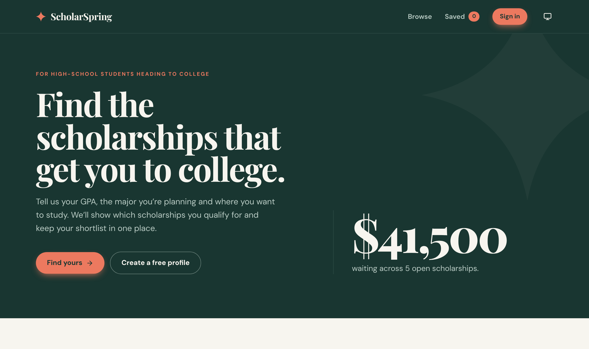

<div align="center">

<picture>
  <source media="(prefers-color-scheme: dark)" srcset=".github/assets/logo-dark.svg">
  
</picture>

<br>

**Find the scholarships that get you to college.**

A scholarship finder for high-school students applying to college. Search and filter awards,<br>
see which ones you qualify for, and keep a shortlist of the ones worth applying to.

<p>
  <a href="https://scholarspring-snowy.vercel.app"><picture><source media="(prefers-color-scheme: dark)" srcset="https://img.shields.io/badge/live_demo-scholarspring--snowy.vercel.app-ec795f?style=flat-square&logo=vercel&logoColor=white&labelColor=3b5a53"></picture></a>&nbsp;
  <a href="#roadmap"><picture><source media="(prefers-color-scheme: dark)" srcset="https://img.shields.io/badge/roadmap-complete-24413b?style=flat-square&labelColor=3b5a53"></picture></a>&nbsp;
  <a href="https://scholarspring-snowy.vercel.app"><picture><source media="(prefers-color-scheme: dark)" srcset="https://img.shields.io/badge/hosted_on-Vercel-24413b?style=flat-square&logo=vercel&logoColor=white&labelColor=3b5a53"></picture></a>&nbsp;
  <a href="https://github.com/joshuatighe/scholarspring/actions/workflows/ci.yml"><picture><source media="(prefers-color-scheme: dark)" srcset="https://img.shields.io/github/actions/workflow/status/joshuatighe/scholarspring/ci.yml?branch=main&style=flat-square&logo=githubactions&label=ci&logoColor=white&labelColor=3b5a53"></picture></a>&nbsp;
  <a href="https://github.com/joshuatighe/scholarspring/commits/main"><picture><source media="(prefers-color-scheme: dark)" srcset="https://img.shields.io/github/last-commit/joshuatighe/scholarspring/main?style=flat-square&logo=github&label=last%20commit&color=24413b&logoColor=white&labelColor=3b5a53"></picture></a>&nbsp;
  <a href="https://github.com/joshuatighe/scholarspring/pulls?q=is%3Apr+is%3Amerged"><picture><source media="(prefers-color-scheme: dark)" srcset="https://img.shields.io/github/issues-pr-closed/joshuatighe/scholarspring?style=flat-square&logo=github&label=pull%20requests&color=24413b&logoColor=white&labelColor=3b5a53"></picture></a>
</p>

<p>
  <a href="https://react.dev"><picture><source media="(prefers-color-scheme: dark)" srcset="https://img.shields.io/badge/React-19-24413b?style=flat-square&logo=react&logoColor=white&labelColor=3b5a53"></picture></a>&nbsp;
  <a href="https://reactrouter.com"><picture><source media="(prefers-color-scheme: dark)" srcset="https://img.shields.io/badge/React_Router-8-24413b?style=flat-square&logo=reactrouter&logoColor=white&labelColor=3b5a53"></picture></a>&nbsp;
  <a href="https://www.typescriptlang.org/docs/"><picture><source media="(prefers-color-scheme: dark)" srcset="https://img.shields.io/badge/TypeScript-7-24413b?style=flat-square&logo=typescript&logoColor=white&labelColor=3b5a53"></picture></a>&nbsp;
  <a href="https://vite.dev/guide/"><picture><source media="(prefers-color-scheme: dark)" srcset="https://img.shields.io/badge/Vite-8-24413b?style=flat-square&logo=vite&logoColor=white&labelColor=3b5a53"></picture></a>&nbsp;
  <a href="https://tailwindcss.com/docs"><picture><source media="(prefers-color-scheme: dark)" srcset="https://img.shields.io/badge/Tailwind_CSS-4-24413b?style=flat-square&logo=tailwindcss&logoColor=white&labelColor=3b5a53"></picture></a>&nbsp;
  <a href="https://supabase.com/docs"><picture><source media="(prefers-color-scheme: dark)" srcset="https://img.shields.io/badge/Supabase-Postgres_%2B_RLS-24413b?style=flat-square&logo=supabase&logoColor=white&labelColor=3b5a53"></picture></a>&nbsp;
  <a href="https://lucide.dev"><picture><source media="(prefers-color-scheme: dark)" srcset="https://img.shields.io/badge/Lucide-icons-24413b?style=flat-square&logo=lucide&logoColor=white&labelColor=3b5a53"></picture></a>&nbsp;
  <a href="https://oxc.rs/docs/guide/usage/linter"><picture><source media="(prefers-color-scheme: dark)" srcset="https://img.shields.io/badge/oxlint-1-24413b?style=flat-square&logo=oxc&logoColor=white&labelColor=3b5a53"></picture></a>&nbsp;
  <a href="https://vitest.dev"><picture><source media="(prefers-color-scheme: dark)" srcset="https://img.shields.io/badge/Vitest-5-24413b?style=flat-square&logo=vitest&logoColor=white&labelColor=3b5a53"></picture></a>&nbsp;
  <a href="https://pnpm.io/motivation"><picture><source media="(prefers-color-scheme: dark)" srcset="https://img.shields.io/badge/pnpm-10-24413b?style=flat-square&logo=pnpm&logoColor=white&labelColor=3b5a53"></picture></a>
</p>

<sub>[Live demo](https://scholarspring-snowy.vercel.app) · [Features](#features) · [Getting started](#getting-started) · [Environment](#environment) · [Scripts](#scripts) · [Deploy](#deploy) · [Roadmap](#roadmap) · [Architecture](#architecture) · [Stack](#stack)</sub>

<br><br>

<picture>
  <source media="(prefers-color-scheme: dark)" srcset=".github/assets/screenshot-dark.png">
  
</picture>

</div>

---

## Features

- **Browse and search.** Search by name, provider or category; filter by major, region and your GPA; sort by deadline
  or award. Filters live in the URL, so a search can be shared and survives a reload.
- **See what you qualify for.** Signed in, every scholarship that fits your GPA, major and region is marked
  **Matches your profile**, and its page shows how you match, criterion by criterion.
- **Deadline cues.** "Closes today", "Closes in 5 days" or "Closed" on every card. Closed scholarships are hidden
  unless you ask for them.
- **A page per scholarship.** Award, deadline, eligibility and requirements, with a link you can share.
- **Saved list.** Heart a scholarship to keep it. If you're signed out, ScholarSpring asks you to sign in and then
  saves it. Your list is stored with your account and follows you to any device.
- **Light and dark.** Follows your system setting, with a light / dark / system toggle in the header.
- **Private by design.** Postgres Row Level Security, not the UI, makes sure each student can only see and change
  their own profile and saved list.
- **Accessible and responsive.** Keyboard navigable with a skip link and visible focus, AA contrast in both themes,
  and works down to 375px wide.

## Getting started

### 1. Prerequisites
- Node.js 20.19+ or 22.12+, and [pnpm](https://pnpm.io) 10 (`corepack enable` picks up the pinned version)
- A free [Supabase](https://supabase.com) project

### 2. Install

```bash
git clone https://github.com/joshuatighe/scholarspring.git
cd scholarspring
pnpm install
cp .env.example .env.local   # then fill in your Supabase URL and anon key
```

### 3. Set up the database

In the Supabase dashboard, open **SQL Editor** and run each file in [`supabase/migrations/`](supabase/migrations) in
order. The first creates the tables, security rules and sign-up trigger; the rest add the demo scholarships (six,
moved into 2027 and worded for high-school seniors, then seven more).

<details>
<summary><strong>Or use the Supabase CLI</strong></summary>

<br>

```bash
pnpm dlx supabase login
pnpm dlx supabase link --project-ref <your-project-ref>
pnpm dlx supabase db push
```

</details>

> [!TIP]
> For instant sign-ups, turn off **Authentication → Sign In / Providers → Email → Confirm email** in Supabase.
> With it on, students confirm their email before their first sign-in, and the app tells them so.

### 4. Run

```bash
pnpm dev
```

Open [localhost:5173](http://localhost:5173), or skip the setup and try the [live demo](https://scholarspring-snowy.vercel.app).

<details>
<summary><strong>Try it out</strong></summary>

<br>

1. Browse or search the scholarships while signed out.
2. Select **Create a free profile** and enter an email, a username, a 6+ character password, a GPA from 0–4, a major and a region.
3. Back in the results, the filters are set from your profile. Change them to explore.
4. Open a scholarship's details and save it.
5. Open **Saved** in the header to see your list.
6. Sign out from the profile dialog, then sign in on another browser or your phone: your list is there too.

</details>

## Known issues

The problems found in the [Round 1 architecture review](docs/CURRENT_ARCHITECTURE.md#problems-we-noticed) are fixed.

- The 13 demo scholarships (fictional names and providers) are the only data. Add or update scholarships in the Supabase dashboard
  (**Table Editor → scholarships**) or with a new migration.
- Accounts from the old browser-only version aren't carried over; students sign up again. The app deletes that old
  data, which included plain-text passwords, from the browser on first load.
- There's no "forgot password" flow yet.

## Environment

| Variable | Where | Description |
| --- | --- | --- |
| `VITE_SUPABASE_URL` | `.env.local`, Vercel | Project URL, e.g. `https://<ref>.supabase.co` |
| `VITE_SUPABASE_ANON_KEY` | `.env.local`, Vercel | Public anon key. Safe in the browser because Row Level Security enforces access |

Find both in Supabase under **Connect** or **Project Settings → API**. Never put the `service_role` key or the database
password in the app, `.env.local`, or Vercel. Without these variables the app shows a setup notice instead of data.

## Scripts

| Command | What it does |
| --- | --- |
| `pnpm dev` | Start the dev server |
| `pnpm build` | Typecheck and build for production into `dist/` |
| `pnpm preview` | Serve the production build |
| `pnpm lint` | Lint with oxlint |
| `pnpm typecheck` | Typecheck only |
| `pnpm test` / `test:watch` | Run the Vitest unit tests (once / watch) |

Every pull request and push to `main` runs lint, typecheck, tests and build in [GitHub Actions](.github/workflows/ci.yml).

## Deploy

1. Import the repo into [Vercel](https://vercel.com/new). The framework preset is **Vite**, and pnpm is detected from
   `pnpm-lock.yaml`. `vercel.json` pins the install, build and output settings.
2. Add `VITE_SUPABASE_URL` and `VITE_SUPABASE_ANON_KEY` under **Settings → Environment Variables**, for Production
   and Preview.
3. In Supabase → **Authentication → URL Configuration**, set the Site URL to your production URL.
4. Deploy. `vercel.json` sends every page route to `index.html`, so links like `/scholarships/stem-forward` work.

Production: **[scholarspring-snowy.vercel.app](https://scholarspring-snowy.vercel.app)**

Every pull request gets its own preview deployment, and merges to `main` go to production.

> [!TIP]
> To have Vercel use the exact pnpm version pinned in `package.json`, add the environment variable
> `ENABLE_EXPERIMENTAL_COREPACK=1` to the Vercel project.

## Roadmap

Each step is its own branch and pull request, merged before the next one starts. The full plan is in [TARGET_ARCHITECTURE.md](docs/TARGET_ARCHITECTURE.md#rollout-plan).

| | Step | Branch | Status |
| --- | --- | --- | --- |
| 0 | Current and target architecture docs | `docs/current-architecture`, `docs/target-architecture` | ✅ Done |
| 1 | New README and `CLAUDE.md` | `docs/readme` | ✅ Done |
| 2 | Fix the Round 1 bugs in the existing code | `fix/round-1-bugs` | ✅ Done |
| 3 | Move to Vite, React, TypeScript, Tailwind, pnpm and Lucide | `chore/vite-react-ts` | ✅ Done |
| 4 | Deploy to Vercel | `chore/vercel-deploy` | ✅ Done |
| 5 | Move data and accounts to Supabase | `feat/supabase` | ✅ Done |
| 6 | UI refresh: bold forest look, pages, dark mode, match and deadline cues | `feat/ui-refresh` | ✅ Done |

## Architecture

| Document | What's in it |
| --- | --- |
| [`docs/CURRENT_ARCHITECTURE.md`](docs/CURRENT_ARCHITECTURE.md) | How the app works today: components, data shapes, a save flow, and the problems found |
| [`docs/TARGET_ARCHITECTURE.md`](docs/TARGET_ARCHITECTURE.md) | Where it's going: new stack, Supabase data model, UI direction and the rollout plan |
| [`CLAUDE.md`](CLAUDE.md) | Requirements, conventions, design language and decisions, for people and AI assistants working on the code |

## Stack

| | |
| --- | --- |
| **Frontend** | Vite · React · React Router · TypeScript (strict) · Tailwind CSS v4 · Lucide icons |
| **Type** | Playfair Display · DM Sans |
| **Data** | Supabase: Postgres, Auth, Row Level Security, all through `src/lib/data.ts` |
| **Tooling** | pnpm · oxlint · Vitest · GitHub Actions |
| **Hosting** | Vercel, with a preview for every PR |

## Project structure

```
src/
  App.tsx           routes and app state (auth, scholarships, saved list, toasts)
  pages/            Home, Browse, Scholarship, Saved, Profile, NotFound
  components/       Header, Footer, Layout, ScholarshipCard, Chips, AuthDialog, ThemeToggle, ...
  context/          AppContext: what every page reads through useApp()
  hooks/            useAuth, useScholarships, useSavedScholarships, useTheme, useToast, useDocumentTitle
  lib/
    data.ts         the only module that talks to Supabase (auth, profiles, scholarships, saved list)
    supabase.ts     the Supabase client, created from the VITE_ environment variables
    database.types.ts  row types for the tables in supabase/migrations
    matching.ts     filters and per-criterion profile matching
    browse.ts       Browse URL state, sorting, hiding closed scholarships
    deadlines.ts    deadline status ("Closes in 5 days")
    format.ts       money and date formatting
    theme.ts        light / dark / system preference
  index.css         Tailwind theme: light and dark colour tokens, fonts, breakpoints
supabase/migrations/  schema, Row Level Security, sign-up trigger, demo scholarships
docs/               current and target architecture
.github/assets/     logo and screenshots used by this README
CLAUDE.md           project guide for contributors and AI assistants
.env.example        the two Supabase variables the app needs
vercel.json         Vercel build settings, headers and page-route rewrite
.github/workflows/  CI: lint, typecheck, test, build
```

---

<div align="center">
<sub>Built for an AI-aided software engineering course · 2026</sub>
</div>
