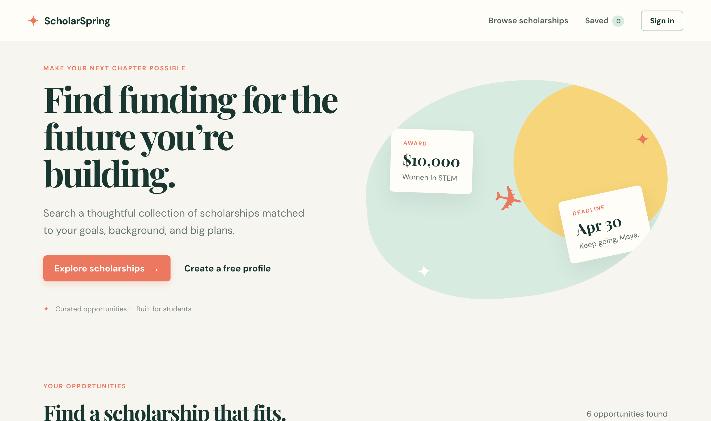

<div align="center">

<picture>
  <source media="(prefers-color-scheme: dark)" srcset=".github/assets/logo-dark.svg">
  
</picture>

<br>

**Find funding for the future you're building.**

A scholarship finder for students. Search and filter awards, build a profile once,<br>
and keep a shortlist of the scholarships worth applying to.

<p>
  <a href="#roadmap"><picture><source media="(prefers-color-scheme: dark)" srcset="https://img.shields.io/badge/roadmap-step_2_of_6-24413b?style=flat-square&labelColor=3b5a53"></picture></a>&nbsp;
  <a href="https://github.com/joshuatighe/scholarspring/commits/main"><picture><source media="(prefers-color-scheme: dark)" srcset="https://img.shields.io/github/last-commit/joshuatighe/scholarspring/main?style=flat-square&logo=github&label=last%20commit&color=24413b&logoColor=white&labelColor=3b5a53"></picture></a>&nbsp;
  <a href="https://github.com/joshuatighe/scholarspring/pulls?q=is%3Apr+is%3Amerged"><picture><source media="(prefers-color-scheme: dark)" srcset="https://img.shields.io/github/issues-pr-closed/joshuatighe/scholarspring?style=flat-square&logo=github&label=pull%20requests&color=24413b&logoColor=white&labelColor=3b5a53"></picture></a>
</p>

<p>
  <a href="https://developer.mozilla.org/en-US/docs/Web/HTML"><picture><source media="(prefers-color-scheme: dark)" srcset="https://img.shields.io/badge/HTML-5-24413b?style=flat-square&logo=html5&logoColor=white&labelColor=3b5a53"></picture></a>&nbsp;
  <a href="https://developer.mozilla.org/en-US/docs/Web/CSS"><picture><source media="(prefers-color-scheme: dark)" srcset="https://img.shields.io/badge/CSS-3-24413b?style=flat-square&logo=css&logoColor=white&labelColor=3b5a53"></picture></a>&nbsp;
  <a href="https://developer.mozilla.org/en-US/docs/Web/JavaScript"><picture><source media="(prefers-color-scheme: dark)" srcset="https://img.shields.io/badge/JavaScript-ES2020-24413b?style=flat-square&logo=javascript&logoColor=white&labelColor=3b5a53"></picture></a>&nbsp;
  <a href="#getting-started"><picture><source media="(prefers-color-scheme: dark)" srcset="https://img.shields.io/badge/build_step-none-24413b?style=flat-square&labelColor=3b5a53"></picture></a>
</p>

<sub>[Features](#features) · [Getting started](#getting-started) · [Roadmap](#roadmap) · [Architecture](#architecture) · [Stack](#stack)</sub>

<br><br>



</div>

---

## Features

- **Search.** Find scholarships by name, provider or category as you type.
- **Filters.** Narrow results by major and region, and enter your GPA to see only awards you qualify for. "Any major" and national awards always show up.
- **Student profile.** Enter your GPA, intended major and preferred region once, and the filters are set for you every time you visit. Sign out and back in; several students can share one browser.
- **Scholarship details.** Open any card for the full description, award, deadline, minimum GPA and who it's for.
- **Saved list.** Heart a scholarship to keep it. The count shows in the header, and your list survives a refresh and signing out.
- **Responsive.** Works on phones, with a collapsible menu below 800px.

> [!NOTE]
> ScholarSpring is being rebuilt step by step (see the [roadmap](#roadmap)). Today it is a frontend-only demo:
> the six scholarships are built in, and your profile and saved list live in your browser's `localStorage`.

## Getting started

There is nothing to install. From the repo root, start any static file server:

```bash
python3 -m http.server 8000
```

Open [localhost:8000](http://localhost:8000).

<details>
<summary><strong>Try it out</strong></summary>

<br>

1. Browse or search the scholarships while signed out.
2. Select **Create a free profile** and enter any username, a 6+ character password, a GPA from 0–4, a major and a region.
3. Back in the results, the filters are set from your profile. Change them to explore.
4. Open a scholarship's details and save it.
5. Open **Saved** in the header to see your list. It is still there after a refresh.
6. Sign out from the profile dialog, then use **Sign in** in the header to get your list back.

</details>

## Known issues

The bugs found in the [Round 1 architecture review](docs/CURRENT_ARCHITECTURE.md#problems-we-noticed) are fixed. What remains is part of the demo design and changes with the stack:

- Accounts and saved lists live only in this browser, and passwords are stored there as plain text. Both go away with Supabase in step 5.
- Scholarships are built into the code, so adding one means editing `app.js`. Also fixed in step 5.

## Roadmap

Each step is its own branch and pull request, merged before the next one starts. The full plan is in [TARGET_ARCHITECTURE.md](docs/TARGET_ARCHITECTURE.md#rollout-plan).

| | Step | Branch | Status |
| --- | --- | --- | --- |
| 0 | Current and target architecture docs | `docs/current-architecture`, `docs/target-architecture` | ✅ Done |
| 1 | New README and `CLAUDE.md` | `docs/readme` | ✅ Done |
| 2 | Fix the Round 1 bugs in the existing code | `fix/round-1-bugs` | 🚧 In progress |
| 3 | Move to Vite, React, TypeScript, Tailwind, pnpm and Lucide | `chore/vite-react-ts` | Planned |
| 4 | Deploy to Vercel | `chore/vercel-deploy` | Planned |
| 5 | Move data and accounts to Supabase | `feat/supabase` | Planned |
| 6 | UI refresh | `feat/ui-refresh` | Planned |

## Architecture

| Document | What's in it |
| --- | --- |
| [`docs/CURRENT_ARCHITECTURE.md`](docs/CURRENT_ARCHITECTURE.md) | How the app works today: components, data shapes, a save flow, and the problems found |
| [`docs/TARGET_ARCHITECTURE.md`](docs/TARGET_ARCHITECTURE.md) | Where it's going: new stack, Supabase data model, UI direction and the rollout plan |
| [`CLAUDE.md`](CLAUDE.md) | Requirements, conventions, design language and decisions, for people and AI assistants working on the code |

## Stack

| | Today | After the rollout |
| --- | --- | --- |
| **Frontend** | HTML · CSS · vanilla JavaScript | Vite · React · TypeScript (strict) · Tailwind CSS |
| **Icons** | Text glyphs (♡ ⌕ ✦) | Lucide |
| **Type** | Playfair Display · DM Sans | Kept, refined in the UI refresh |
| **Data** | Built-in array + `localStorage` | Supabase: Postgres, Auth, Row Level Security |
| **Tooling** | None | pnpm |
| **Hosting** | Any static server | Vercel |

## Project structure

```
index.html          page layout, profile and detail dialogs
styles.css          all styling; the colour palette lives in :root
app.js              scholarship data, filtering, profile, saving
docs/               current and target architecture
.github/assets/     logo and screenshot used by this README
CLAUDE.md           project guide for contributors and AI assistants
```

---

<div align="center">
<sub>Built for an AI-aided software engineering course · 2026</sub>
</div>
