# ScholarSpring — Current Architecture (Round 1)

This document describes the architecture of ScholarSpring **as it was handed over from Vibe Coding 1** (commit `74e68bb`, "init: original code"). Nothing in the application was changed while writing it. It was reverse-engineered with a generative-AI coding assistant (Claude Code). The assistant read every source file, traced the call graph, and ran small experiments against the filtering logic. The prompts used are listed in [Appendix A](#appendix-a--how-this-document-was-produced).

All diagrams use [Mermaid](https://mermaid.js.org/), which GitHub renders inline.

---

## 1. System at a glance

| Aspect | Current state |
|---|---|
| Type | Static, frontend-only single-page app (SPA) |
| Languages | HTML5, CSS3, vanilla JavaScript (ES2020+, no modules) |
| Source size | 3 source files, ~11 KB total: `index.html` (68 lines), `app.js` (27 dense lines), `styles.css` (3 minified lines) |
| Frameworks / libraries | None. The only external resource is Google Fonts (DM Sans, Playfair Display) |
| Build / package manager | None. No `package.json`, bundler, or transpiler |
| Backend / API | None |
| Database | None. Scholarships are hard-coded in a JS array, and user state lives in browser `localStorage` |
| Authentication | Simulated. One local "profile" with a plaintext password and no real sign-in |
| Routing | Hash anchors (`#home`, `#search`, `#saved`) that scroll within one page |
| Tests / CI | None |
| Hosting | Any static file server (README suggests `python3 -m http.server 8000`) |

**Functional scope (from README):** students can search the seeded scholarships by name or keyword, filter by major, region, and minimum GPA, create a profile (username, password, GPA, major, region) that pre-fills the filters, view scholarship details in a modal, and save or unsave scholarships. Saved items persist across reloads.

> README mentions `HW05-reflection.md` and `Requirements gathering.docx`, but neither file is in the repository.

---

## 2. System context (C4 level 1)

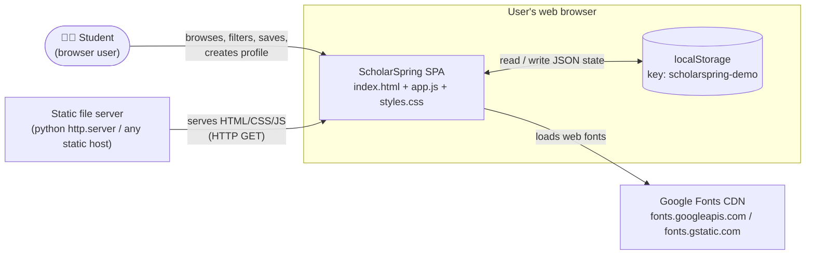

The system has **no server-side logic**. After the three static files load, everything runs in the browser, and the only data that persists is the JSON blob in `localStorage`.

---

## 3. Deployment view

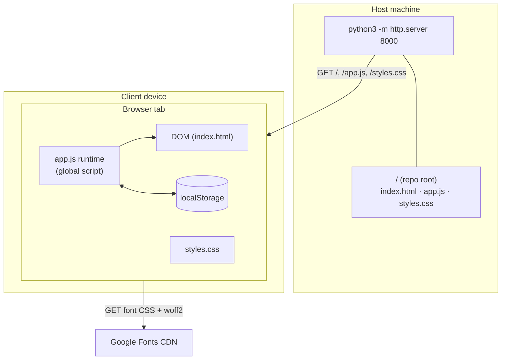

---

## 4. Component diagram (C4 level 2–3)

The repo has three files, but `app.js` contains several distinct logical components. Each one is a group of top-level functions and constants that share one global scope.

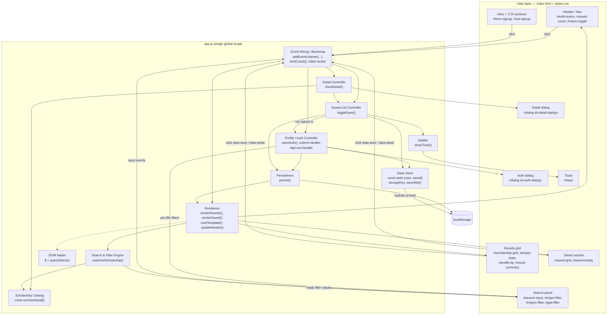

### Component responsibilities

| Component | Members in `app.js` | Responsibility |
|---|---|---|
| **Scholarship Catalog** | `scholarships` | Six hard-coded `Scholarship` records. This is the only data source. |
| **State Store** | `storageKey`, `state`, `savedIds()` | One mutable global object `{user, saved}`, hydrated from `localStorage` when the script loads. |
| **Persistence** | `persist()` | Serializes `state` to `localStorage`, then **re-renders the whole UI**: header, saved grid, and results. |
| **Search & Filter Engine** | `matchesScholarship(s)` | Predicate that reads the four filter controls **directly from the DOM** and tests one scholarship. |
| **Renderers** | `renderResults()`, `renderSaved()`, `cardTemplate(s)`, `updateHeader()` | Build HTML strings with template literals, assign them through `innerHTML`, and toggle empty-state classes. |
| **Card binding** | `bindCards(container)` | Re-attaches click listeners to `[data-save]` and `[data-detail]` buttons after every render. |
| **Detail Controller** | `showDetail(id)` | Builds the detail modal HTML, opens `<dialog>`, and wires its save button. |
| **Saved-List Controller** | `toggleSave(id)` | Requires a profile, adds or removes the ID in `state.saved`, shows a toast, and calls `persist()`. |
| **Profile/Auth Controller** | `openAuth()`, `#auth-form` submit, `#switch-auth` click | Opens the profile form, creates or updates the single local user, maps the profile onto the filters, and handles sign-out. |
| **Notifier** | `showToast(msg)` | Shows a transient status message for 2.6 s. |
| **Bootstrap** | bottom of the file | Registers all event listeners, then calls `updateHeader(); renderResults(); renderSaved();`. |

---

## 5. Class diagram

ScholarSpring defines **no JavaScript classes**. It is procedural code over plain object literals. The diagram below is a *logical* class model recovered from the code. `«data»` types are the object shapes the code relies on. `«module»` types group the global functions by responsibility, the way they would sit in a class-based design.

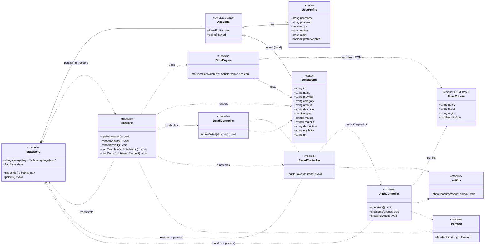

### Entity-relationship view of persisted data

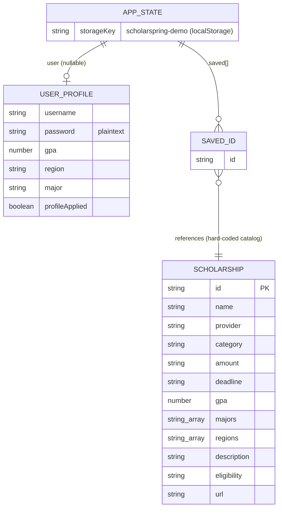

Example of the `localStorage` value:

```json
{"user":{"username":"maya.chen","password":"secret1","gpa":3.7,"region":"Midwest","major":"Computer Science","profileApplied":true},"saved":["stem-forward","women-build"]}
```

---

## 6. Function call graph

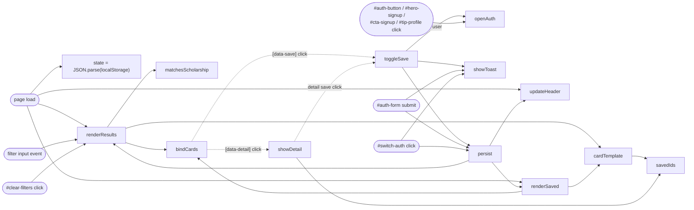

---

## 7. Key runtime behaviours (sequence diagrams)

### 7.1 Page load / hydration

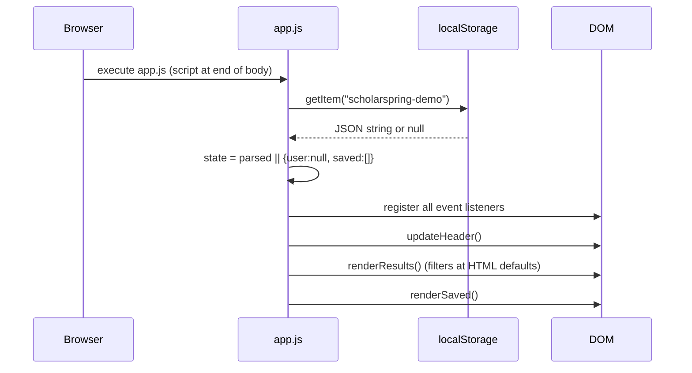

Filters are **not** persisted, so after a reload a signed-in user's personalized filters reset to "All".

### 7.2 Create / update profile

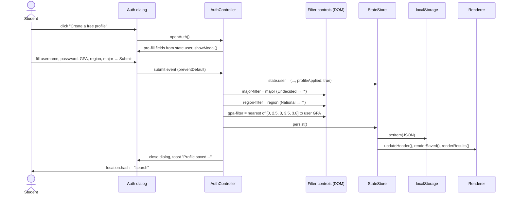

### 7.3 Save / unsave a scholarship

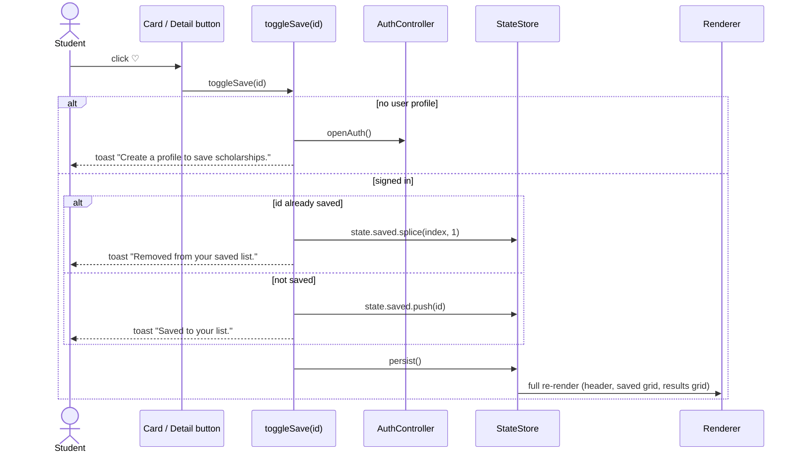

### 7.4 Search / filter

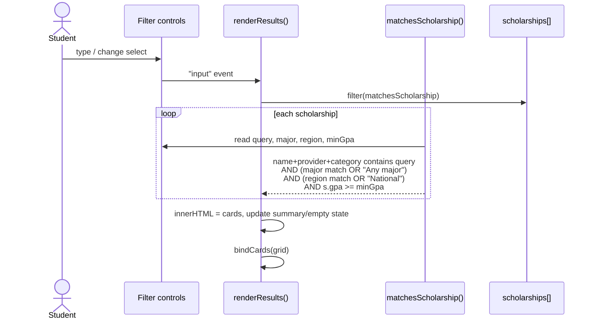

---

## 8. Application state machine

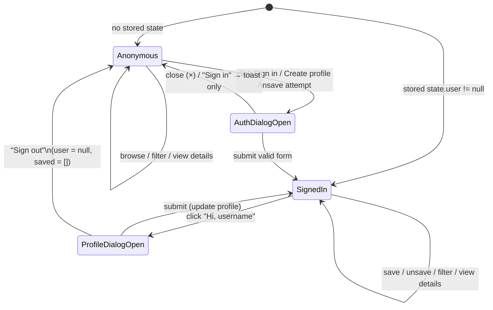

There is no true "sign in" path. "Already have a profile? Sign in" only shows a toast, because the app keeps exactly one profile per browser.

---

## 9. UI structure (page composition)

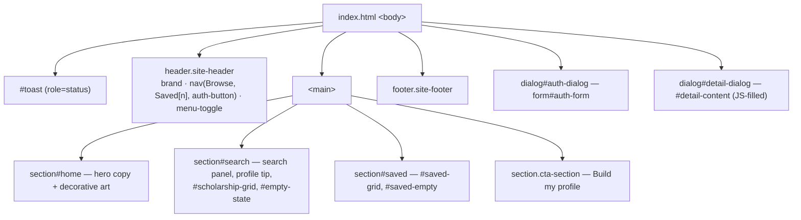

**Styling:** a single minified stylesheet. It uses CSS custom properties for the palette (`--ink`, `--cream`, `--coral`, `--mint`, …), sticky header, CSS grid card layout, and two responsive breakpoints (`max-width: 800px`, `max-width: 500px`). Nav collapses behind `#menu-toggle` on small screens. Modals use the native `<dialog>` element with `showModal()`.

---

## 10. Architectural characteristics & observations

### Strengths
- **Zero dependencies and zero build.** It runs from any static host and is easy to demo.
- **Native platform features:** `<dialog>`, `localStorage`, and `role="status"` for the toast, plus `aria-label`s on icon buttons.
- **Clear data model.** Scholarships are self-describing records with `majors[]` and `regions[]` arrays and wildcards (`"Any major"`, `"National"`).
- **Responsive design** with CSS variables, which keeps the palette consistent.

### Architectural style
- A **"smart view" / transaction-script** style. There is no separation between model, view, and controller. One global mutable `state` object plus a `persist()` function acts as a crude unidirectional loop: *mutate → persist → re-render everything*.
- The **DOM is the source of truth for filters.** `matchesScholarship()` reads the `<select>` and `<input>` values on every call, so filter logic cannot run or be tested without a DOM.
- **String-template rendering** through `innerHTML`, with listeners re-bound after each render.

### Technical debt, risks, and defects found

| # | Area | Finding | Evidence |
|---|---|---|---|
| 1 | **Correctness (high)** | **The profile's GPA filter is inverted.** The filter keeps scholarships whose *required* GPA is **≥** the selected value. On profile save, the user's GPA is snapped to the *nearest* option, which can round **up**. Students with higher GPAs therefore see *fewer* scholarships. A 3.7 or 4.0 student sees **0 results** even though they qualify for all 6. A 2.6 student sees all 6 but qualifies for only 1. | `app.js:13` `s.gpa>=minGpa`; `app.js:24` nearest-value `reduce`. Simulated: GPA 2.6→shown 6/eligible 1; 3.2→4/5; 3.4→1/5; 3.7→0/6; 4.0→0/6 |
| 2 | Security | The password is stored **in plaintext** in `localStorage` and pre-filled back into the form. There is no real authentication, and anyone with access to the browser can read it. | `app.js:24`, `app.js:21` |
| 3 | Security | Unescaped `innerHTML` interpolation. This is safe today only because the data is hard-coded. It becomes an XSS vector once data comes from users or an API. | `cardTemplate`, `showDetail` |
| 4 | Functionality | "Sign in" isn't implemented (toast only). Sign-out **erases saved scholarships**. Only one profile per browser is possible. | `app.js:22` |
| 5 | Dead code | `profileApplied` is always set to `true` on submit, so `#profile-tip` can never appear. `Scholarship.url` is always `'#'` and never used. | `app.js:16`, `app.js:24` |
| 6 | UX/state | Personalized filters are not persisted and reset on reload. After a reload, the user stays signed in but sees unpersonalized results. | §7.1 |
| 7 | Data | `amount` and `deadline` are display strings, so the app can't sort by amount or flag expired deadlines. `cardTemplate` hard-codes stripping `', 2026'`. Majors and regions are duplicated between `index.html` options and the data. | `app.js:2-7`, `app.js:14` |
| 8 | Data | The profile major option `Undecided` has no matching scholarship major. Region `South` exists in the filters but no scholarship lists it, so only National awards match. | `index.html` selects vs. data |
| 9 | Maintainability | Code is written in a minified style: 27 lines, many statements per line, single global scope, no modules, no comments. `styles.css` is fully minified. | all files |
| 10 | Performance | Every `persist()` re-renders all grids and re-binds every listener. `savedIds()` builds a new `Set` per card. This is fine at 6 records but scales poorly. | `app.js:12`, `app.js:14` |
| 11 | Quality | No tests, linter, CI, or `package.json`. Files referenced in README (`HW05-reflection.md`, `Requirements gathering.docx`) are missing. | repo root |
| 12 | Scalability | No backend, so the catalog can't be updated without a code change, and no data is shared across devices or users. | §2 |

---

## Appendix A — How this document was produced

The analysis used **Claude Code** (an agentic AI coding assistant) running against a fresh clone of the repository.

**Prompt given to the AI tool:**

> *"Round 1: Current Architecture. For this assignment, you will be starting with the code and system created by the team that was assigned this app for Vibe Coding 1. Use gen AI tools and prompts to determine the current architecture of that system. Include class diagrams, component diagrams, etc."*

**Steps the AI assistant performed:**
1. Listed the repository and git history to establish scope: three source files and one commit.
2. Read `README.md`, `index.html`, `app.js`, and the structure of `styles.css` (custom properties, media queries).
3. Grouped `app.js`'s top-level functions into logical components by the state they touch and the DOM they write. This grouping produced the component and class diagrams.
4. Traced every event listener to build the call graph and the sequence diagrams.
5. Inferred the data schemas from the object literals and the `localStorage` write path, which produced the class and ER diagrams.
6. Checked a suspicious piece of logic (GPA snapping against the `>=` filter) with a short Node.js simulation, which confirmed finding #1.

**Follow-up prompts useful for later rounds:**
- "Generate a C4 container diagram for a target architecture that adds a REST backend and a real database for ScholarSpring."
- "Refactor `app.js` into ES modules (data, state, filters, render, controllers) without changing behaviour, and add unit tests for `matchesScholarship`."
- "Fix the GPA eligibility filter so it shows scholarships whose minimum GPA is ≤ the student's GPA."
