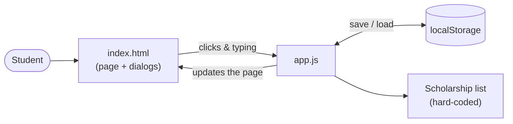
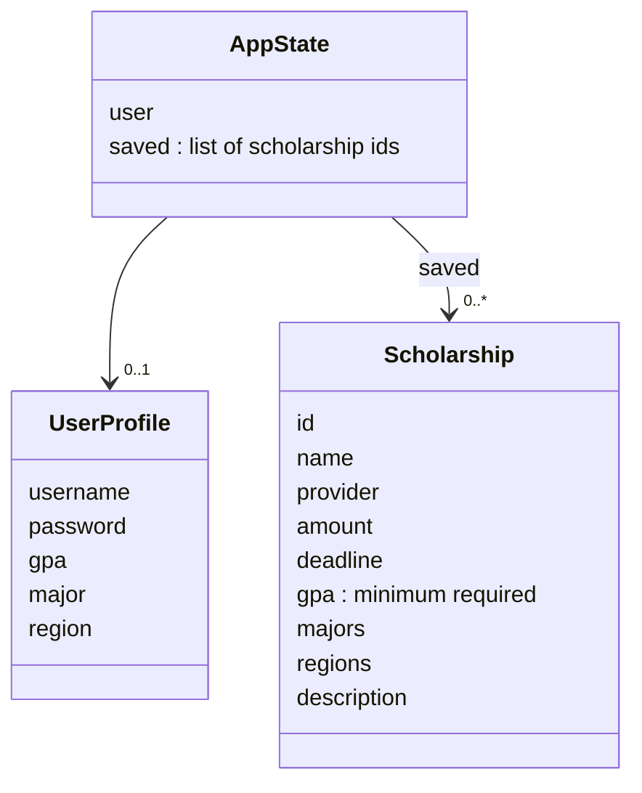
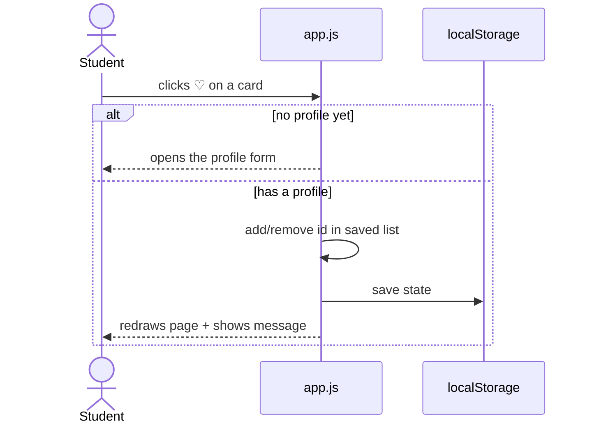

# ScholarSpring — Current Architecture

This document describes ScholarSpring as we received it from the Vibe Coding 1 team (commit `74e68bb`). It was produced with an AI coding assistant (Claude Code), which read the source files and summarized how they fit together.

## Overview

ScholarSpring is a **frontend-only** web app. There is no server, no database, and no build step. It is just three files:

| File | What it does |
|---|---|
| `index.html` | Page layout: header, search panel, results, saved list, and two pop-up dialogs (profile and scholarship details) |
| `styles.css` | All styling, including a mobile layout |
| `app.js` | All logic: the scholarship data, search/filtering, profiles, and saving |

- **Data:** six scholarships are hard-coded in an array in `app.js`.
- **Storage:** the user's profile and saved scholarships are stored in the browser's `localStorage`, so they survive a page refresh but stay on that one browser.
- **Running it:** serve the folder with any static server, e.g. `python3 -m http.server 8000`.

## Component diagram

Inside `app.js`, the functions fall into a few groups:

| Group | Functions | Job |
|---|---|---|
| Search & filter | `matchesScholarship` | Checks a scholarship against the search box and filters |
| Display | `renderResults`, `renderSaved`, `cardTemplate`, `showDetail` | Builds the HTML for cards and the detail pop-up |
| Profile | `openAuth`, form submit handler | Creates/updates the profile and pre-fills the filters from it |
| Saving | `toggleSave`, `persist` | Adds/removes saved scholarships and writes to `localStorage` |

Every change follows the same simple loop: **update `state` → `persist()` saves it → the whole page is redrawn.**

## Class diagram

The code has no JavaScript classes; it uses plain objects. These are the shapes of the data it works with:

`AppState` is what gets saved to `localStorage`.

## Example flow: saving a scholarship

## Problems we noticed

1. **GPA filter is backwards.** After you create a profile, the app shows scholarships whose required GPA is *higher* than yours. A student with a 3.7 GPA sees no results at all.
2. **Passwords are stored as plain text** in `localStorage`.
3. **"Sign in" doesn't work.** It only shows a message. Signing out also deletes your saved list.
4. **Hard to maintain.** All the logic sits in one 27-line file, with many statements packed onto each line. There are no tests.
5. **No backend.** Adding a scholarship means editing the code, and data can't be shared between devices.

## How this was produced

Prompt given to the AI assistant:

> *"Use gen AI tools and prompts to determine the current architecture of that system. Include class diagrams, component diagrams, etc."*

The assistant read every file, grouped the functions in `app.js` by what they do, drew the diagrams in Mermaid, and ran a quick test to confirm the GPA filter problem. A follow-up prompt then asked it to simplify the document for an entry-level audience.
