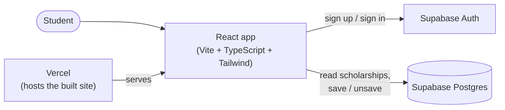
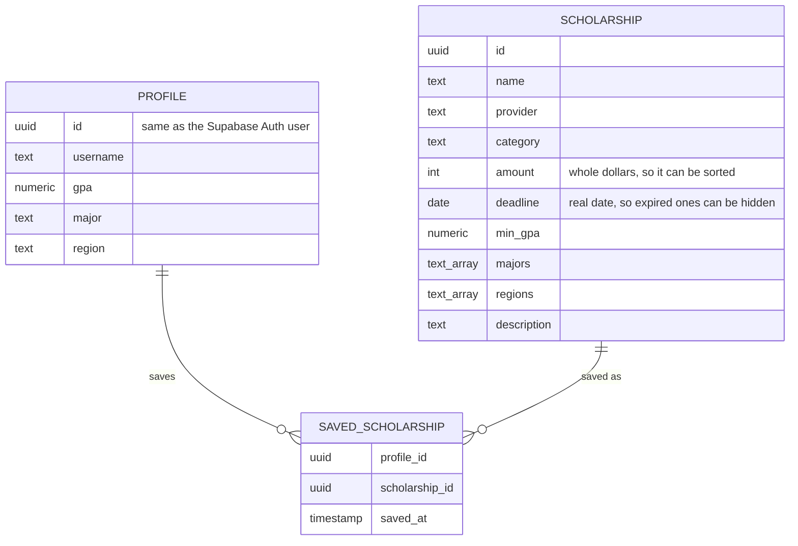
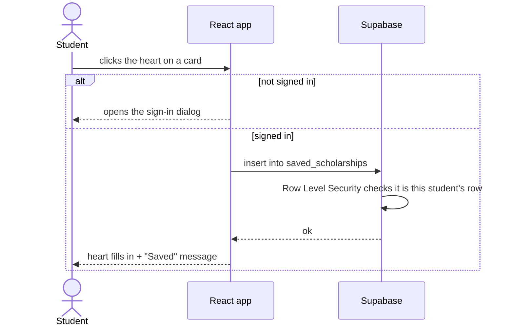

# ScholarSpring — Target Architecture

This document describes the architecture we want ScholarSpring to move to. It builds on [CURRENT_ARCHITECTURE.md](./CURRENT_ARCHITECTURE.md) (Round 1). Nothing here is implemented yet. The work happens on separate branches, in the order listed under [Rollout plan](#rollout-plan).

## Current vs. intended

The original design called for students to search scholarships, create a real profile, get results matched to that profile, and save scholarships. The Round 1 diagrams show where the built system fell short of that:

| Intended | What Round 1 found | Target |
|---|---|---|
| Real accounts with sign-in | Fake sign-in; password stored in plain text in the browser | Supabase Auth (email + password, hashed, real sessions) |
| Results matched to the student's profile | GPA filter is backwards; a 3.7 student sees nothing | Fixed and unit-tested matching logic |
| A growing list of scholarships | 6 scholarships hard-coded in `app.js` | Scholarships stored in a Supabase database |
| Saved scholarships that follow the student | Saved list lives in one browser and is wiped on sign-out | Saved list stored per user in the database |
| Maintainable code | One dense 27-line file, no tests | Typed React components, small modules, tests |

## Tech stack

| Layer | Now | Target |
|---|---|---|
| Build tool | None | **Vite** |
| UI | Hand-written HTML strings | **React** components |
| Language | JavaScript | **TypeScript** (strict) |
| Styling | One minified CSS file | **Tailwind CSS** |
| Icons | Emoji / text glyphs (♡, ⌕, ✦) | **Lucide** icons |
| Package manager | None | **pnpm** |
| Data & accounts | `localStorage` | **Supabase** (Postgres database + Auth) |
| Hosting | `python3 -m http.server` | **Vercel** |

## Component diagram

The app is still a single-page site, but it is now built with Vite and deployed to Vercel. All data and accounts live in Supabase. There is still no custom server: the browser talks to Supabase directly, and database rules (Row Level Security) make sure each student can only see and change their own profile and saved list.

Inside the React app, the code is split by job:

| Folder | What lives there |
|---|---|
| `src/components/` | UI pieces: `Header`, `SearchPanel`, `ScholarshipCard`, `DetailDialog`, `ProfileDialog`, `SavedList` |
| `src/hooks/` | `useAuth`, `useScholarships`, `useSavedScholarships`: load data and expose it to components |
| `src/lib/matching.ts` | Pure filtering and matching functions (no UI, easy to unit test) |
| `src/lib/data.ts` | The only file that talks to storage. It starts out using `localStorage` and is later switched to Supabase, so the rest of the app doesn't change |
| `src/types.ts` | Shared TypeScript types: `Scholarship`, `Profile`, `SavedScholarship` |

## Data model

Passwords are not in this model at all. Supabase Auth stores them, hashed.

## Example flow: saving a scholarship

## UI direction

The goal is a clean, modern look that still feels like ScholarSpring, not a generic purple-gradient template.

- **Keep and refine the current identity:** warm paper background, deep green text, coral accent, and a serif display font for headlines paired with a clean sans-serif for body text.
- **Light and dark mode**, both designed on purpose, not just inverted.
- **Lucide icons** in place of emoji glyphs, for consistent, accessible icons.
- **Robust states:** loading skeletons, empty states, and error messages for every list. Works from phone width up, and is fully keyboard navigable.
- **Clearer cards:** amount, deadline (with "closes in 5 days" when it's close), and a "you qualify" indicator based on the student's profile.

## Rollout plan

Each step is its own branch and pull request, merged before the next one starts.

1. **`docs/readme`**: new `README.md` in the style of [jobboard](https://github.com/joshuatighe/jobboard), with a centered logo and tagline, badges for the live demo and stack, and Features, Getting started, Environment, Scripts, Deploy and Stack sections. Also adds a `CLAUDE.md` with the requirements, conventions and decisions for AI-assisted work.
2. **`fix/round-1-bugs`**: fix the problems from Round 1 in the existing code: the backwards GPA filter, the profile tip that never shows, sign-out deleting saved items, and filters resetting on reload.
3. **`chore/vite-react-ts`**: move the current UI, as-is, to Vite + React + TypeScript + Tailwind + pnpm + Lucide. Data still uses `localStorage`, but only through `src/lib/data.ts`. Add tests for the matching logic.
4. **`chore/vercel-deploy`**: deploy to Vercel with a live demo URL; every pull request gets a preview link.
5. **`feat/supabase`**: create the tables above, add Row Level Security, seed the six scholarships, switch `src/lib/data.ts` to Supabase, and replace the fake sign-in with Supabase Auth.
6. **`feat/ui-refresh`**: the new UI described above.

## How this was produced

Prompt given to the AI assistant (Claude Code), together with the Round 1 document and the jobboard README as a style reference:

> *"Round 2: Target Architecture. Compare the Round 1 diagrams to the architecture that was originally intended. Target: Vite, React, TypeScript, Tailwind CSS, pnpm, Lucide icons, deployed to Vercel, with a Supabase database, a modern and unique UI (not purple-gradient AI style), and a modern README. Order: README and CLAUDE.md, bug fixes, tech-stack migration, Vercel deployment, Supabase migration, UI refresh."*

The assistant compared the Round 1 findings with the original requirements, designed the target components, data model and flow, and drew the diagrams in Mermaid.
